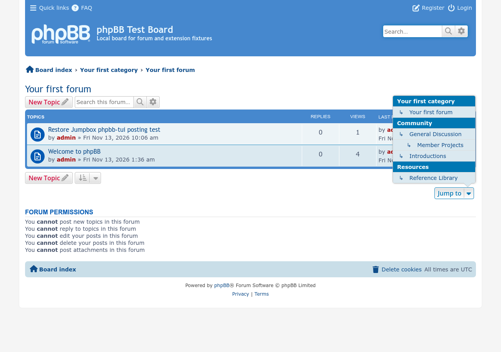
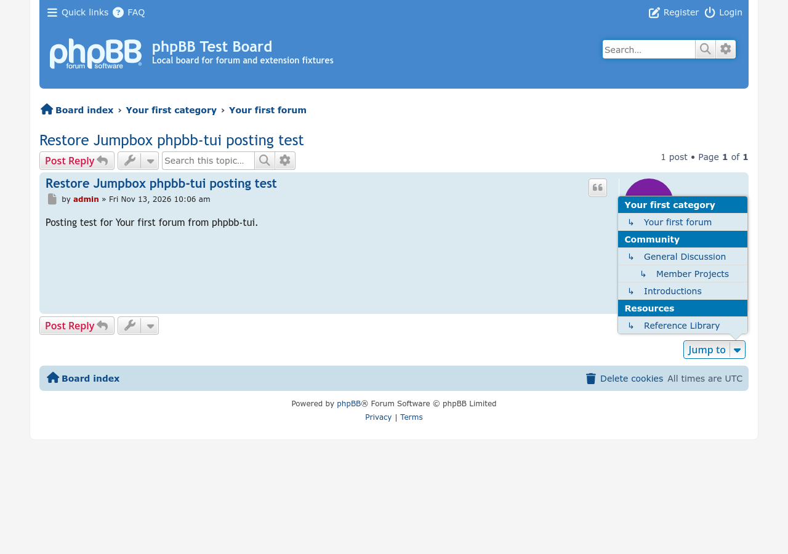

# Restore Jumpbox

A development extension that restores the public forum jumpbox on prosilver forum and topic pages after the removal proposed in [phpBB PR #6927](https://github.com/phpbb/phpbb/pull/6927).

For testing on phpBB 4.0 with the removal applied, place the extension in `ext/phpbbmodders/restorejumpbox` and enable **Restore Jumpbox** in the ACP.

In **ACP → General → Load settings**, set **Show the public jumpbox** to **No** to hide the selector while keeping its permission-filtered links available to phpbb-tui.

## Screenshots

[Full screenshot gallery](docs/images/screenshots/README.md)

## TODO

See the [scope and acceptance checks](docs/TODO.md).

## Contributing

- [Report a bug](https://github.com/phpbbmodders/restorejumpbox/issues).
- [Ask a question or propose a feature](https://github.com/phpbbmodders/restorejumpbox/discussions).

## Acknowledgments

- Initial scope drafted with [Codex](https://openai.com/codex/).

## License

Licensed under the [GNU General Public License v2.0](license.txt).
