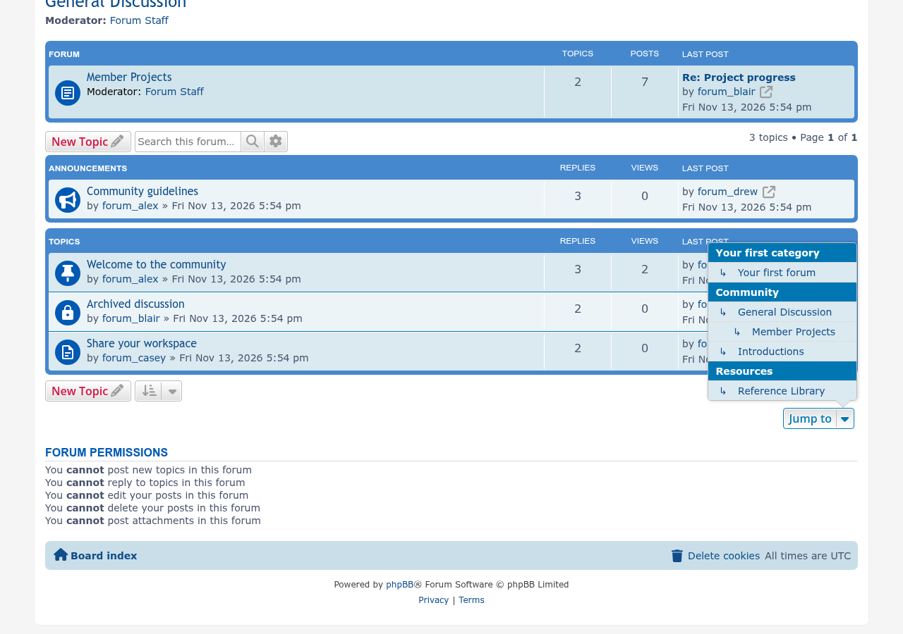
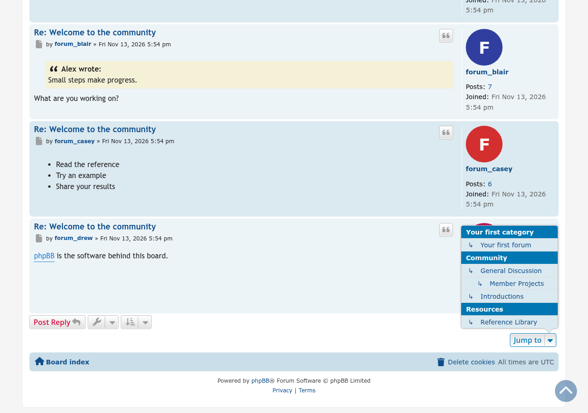
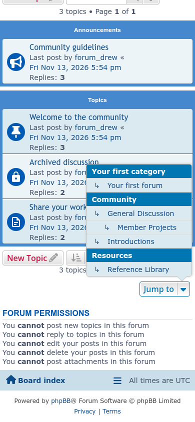

# Restore Jumpbox screenshots

Taken with [phpbb-release-tools](https://github.com/phpbbmodders/phpbb-release-tools)' `phpbb-test-board/screenshots.py` (`shots_restorejumpbox`) on a [seed-forum](https://github.com/phpbbmodders/seed-forum) board built from [phpBB PR #6927](https://github.com/phpbb/phpbb/pull/6927) with seed-forum's standard fixtures. The phpbb-test-board README has the commands.

## Forum page

## Topic page

## Mobile forum page

## ACP Load settings

